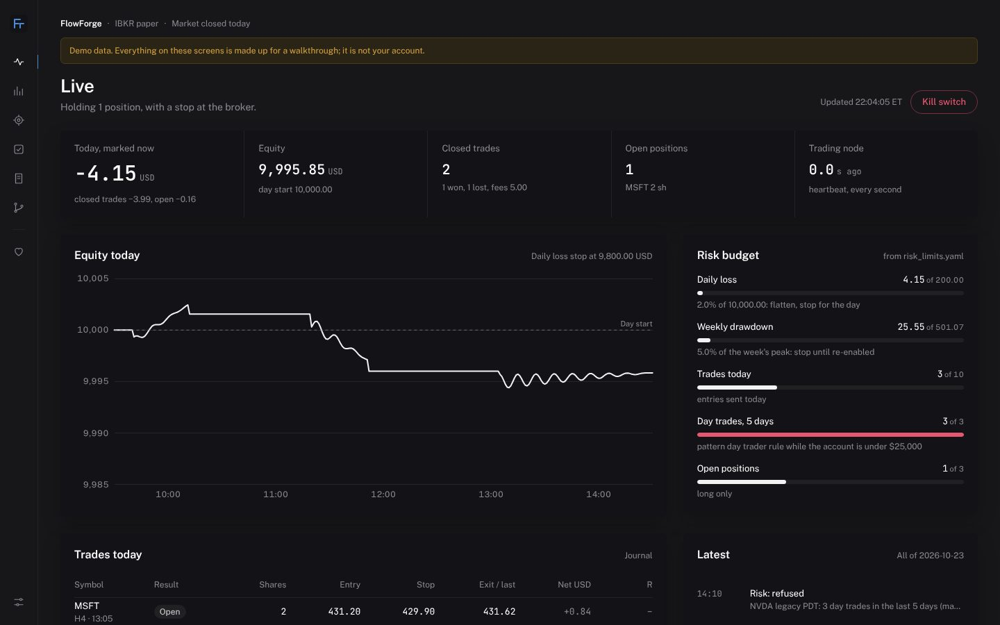
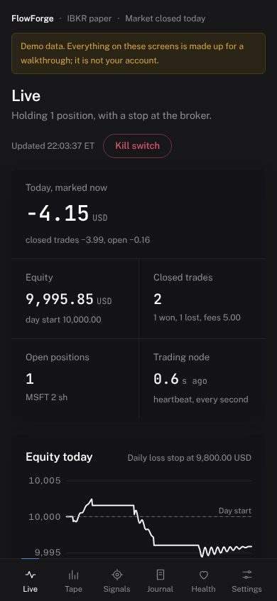
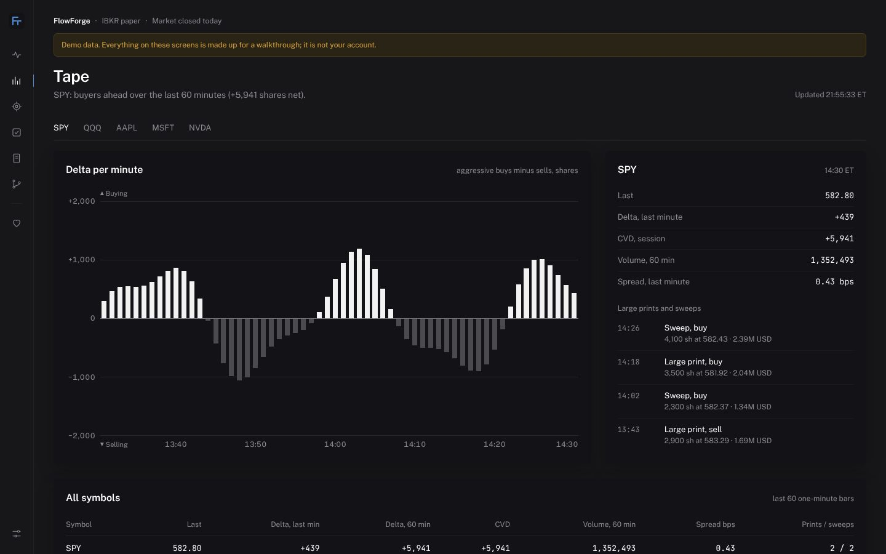
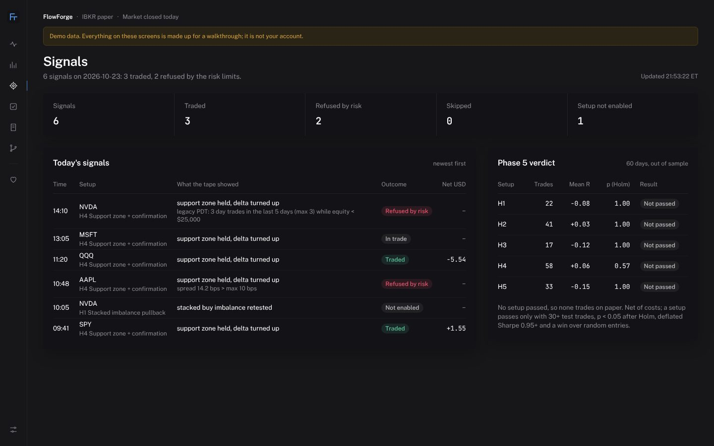
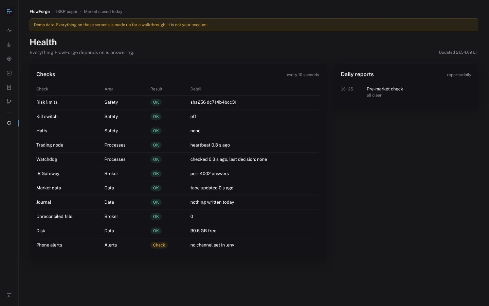
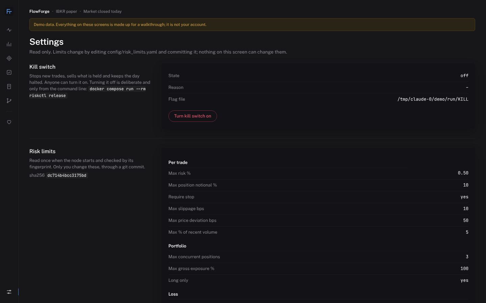

# Phase 6 demo: dashboard, alerts, daily reports

Built 2026-10-26 (ADR-0015). Screens shown with the built-in demo data
(`python -m flowforge.api --demo data/demo`), which invents one paper day on a $10,000
account under the real limits: a SPY target (+1.55 USD), a QQQ stop (−5.54 USD), an open
MSFT position, an AAPL signal refused for a wide spread, an NVDA signal refused by the
3-day-trades-in-5-days rule, and a setup that isn't enabled. The walk-forward table on
Signals is invented too (no setup passes); the real one comes from the Phase 5 run.

Note what the demo already shows about the real account: with the 10% position cap, a
$10,000 account buys one SPY share, and IBKR's $1 minimum commission each way eats most of
a winning trade (+3.55 gross, +1.55 net).

| Screen | |
|---|---|
| Live |  |
| Live, phone |  |
| Tape |  |
| Signals |  |
| Health |  |
| Settings |  |

## Checks
- Tests: 331 pass (`pytest --cov`), total coverage 96%, risk package 99%, risk limits loader
  100%. New: API (read views, findings, kill switch guard, nothing can release), ledger
  (trades rebuilt from order events, unreconciled fills, secret masking), alerts (ntfy and
  Telegram requests, de-duplication, the journal follower), daily reports and schedule,
  tape snapshot, equity marks in a Nautilus run.
- Design: Taste Skill inspector, `--app` rules, on all screens at 1440, 768 and 390 px:
  0 FAIL. One warning kept on purpose: most text is 12-13 px, the dealt "data-terminal"
  style's dense body size for long monitoring sessions.
- Lint, format and the risk-bypass guard are clean.

## Not done yet (Phase 7)
- Real data on these screens: the trading node isn't running on paper yet.
- Phone alerts tested against a real ntfy topic or Telegram bot: needs the operator's
  channel (docs/runbooks/alerts.md).
- Exit gate: the operator's walkthrough.
